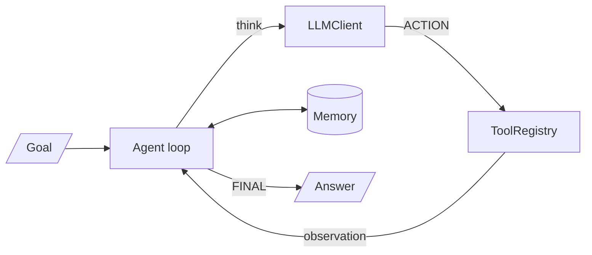

<p align="center"></p>

# AI Agent Framework

**A minimal, dependency-light Python framework for building LLM agents — a `perceive → think → act` control loop, a pluggable tool protocol, a memory store, and an LLM client abstraction that runs fully offline.**

*Built and maintained by [Viprasol Tech](https://viprasol.com) — Fintech Experts. Full-Stack Builders.*

[](https://github.com/Viprasol-Tech/ai-agent-framework/actions)
[](LICENSE)
[](https://www.python.org/)
[](https://github.com/astral-sh/ruff)
[](https://t.me/viprasol_help)
[](https://github.com/Viprasol-Tech/ai-agent-framework/stargazers)

---

## ✨ Features

- 🔁 **Tiny control loop** — a clean, bounded `perceive → think → act` (ReAct-style) agent loop.
- 🧩 **Pluggable tools** — a structural `Tool` protocol; any class with `name`, `description`, and `run()` works.
- 🛠️ **Real example tools** — a safe AST-based `calculator`, an `echo` tool, and a `memory_search` tool.
- 🧠 **Memory store** — an ordered, deterministic keyword-searchable memory you can swap for a vector DB.
- 🤖 **LLM abstraction** — a one-method `LLMClient` ABC; bring any backend.
- 🧪 **Deterministic `FakeLLM`** — the whole framework runs and tests **with no network and no API key**.
- 🔌 **Optional OpenAI client** — lazy-imported, so it is never a hard dependency.
- 🖥️ **Zero-dependency CLI** — `agent-framework run "..."` driven by `argparse`.
- ✅ **Strict tooling** — `ruff`, `mypy --strict`, `pytest` (35 tests), CI across 3 OSes × 3 Python versions.
- 🐳 **Docker-ready** — a slim image runs the demo out of the box.
- 📦 **Modern packaging** — `hatchling`, `src/` layout, `py.typed`, single-source `pyproject.toml`.

## 🚀 Quickstart

```bash
pip install git+https://github.com/Viprasol-Tech/ai-agent-framework.git

# Run the agent against a goal — no API key needed (uses the deterministic FakeLLM)
agent-framework run "2 * (3 + 4)" --verbose
agent-framework run "recall the summit date"
```

Or run the bundled demo straight from a clone:

```bash
git clone https://github.com/Viprasol-Tech/ai-agent-framework.git
cd ai-agent-framework
pip install -e ".[dev]"
python examples/demo.py
```

## 🧱 Architecture

| Component | Module | Responsibility |
| --- | --- | --- |
| **Agent** | `ai_agent_framework.agent` | Runs the bounded `perceive → think → act` loop. |
| **Tool protocol** | `ai_agent_framework.tools` | `Tool`/`ToolResult`/`ToolRegistry` + example tools. |
| **Memory** | `ai_agent_framework.memory` | Ordered store with deterministic keyword search. |
| **LLM client** | `ai_agent_framework.llm` | `LLMClient` ABC, `FakeLLM`, optional `OpenAIClient`. |
| **CLI** | `ai_agent_framework.cli` | `argparse` entry point (`agent-framework`). |



## 📖 Usage

```python
from ai_agent_framework import (
    Agent,
    CalculatorTool,
    EchoTool,
    FakeLLM,
    Memory,
    MemorySearchTool,
    ToolRegistry,
)

memory = Memory()
memory.add("The Viprasol AI summit is on March 1st.", kind="fact")

agent = Agent(
    FakeLLM(),  # swap for OpenAIClient() for real model calls
    ToolRegistry([CalculatorTool(), EchoTool(), MemorySearchTool(memory)]),
    memory=memory,
)

result = agent.run("2 * (3 + 4)")
print(result.answer)  # -> "14"
print(result.completed)  # -> True
for step in result.steps:
    print(step.tool, step.tool_input, "->", step.observation)
```

### Bringing your own LLM

```python
from ai_agent_framework.llm import LLMClient, Message


class MyLLM(LLMClient):
    def complete(self, messages: list[Message]) -> str:
        # call any backend, return one line: "ACTION: tool(arg)" or "FINAL: answer"
        ...
```

To use the optional OpenAI-compatible backend:

```bash
pip install "ai-agent-framework[openai]"
export OPENAI_API_KEY=sk-...
agent-framework run "summarise our roadmap" --llm openai
```

## 🗺️ Roadmap

- [x] Control loop, tool protocol, memory, LLM abstraction, FakeLLM
- [x] CLI, Docker image, CI matrix, strict typing
- [ ] Streaming token support in `LLMClient`
- [ ] Async agent loop
- [ ] Vector-backed memory adapter
- [ ] Built-in tools for HTTP and filesystem access

## 🤝 Contributing

Contributions are welcome! Please read [CONTRIBUTING.md](CONTRIBUTING.md) and our [Code of Conduct](CODE_OF_CONDUCT.md). Security issues: see [SECURITY.md](SECURITY.md).

## 📬 Contact — Viprasol Tech Private Limited

- 🌐 Website: [viprasol.com](https://viprasol.com)
- ✉️ Email: [support@viprasol.com](mailto:support@viprasol.com)
- 💬 Telegram: [t.me/viprasol_help](https://t.me/viprasol_help) · 📱 WhatsApp: +91 96336 52112
- 🐙 GitHub: [@Viprasol-Tech](https://github.com/Viprasol-Tech) · 💼 [LinkedIn](https://www.linkedin.com/in/viprasol/) · 𝕏 [@viprasol](https://twitter.com/viprasol)

> *Viprasol Tech — fintech software, algorithmic trading systems, MT4/MT5 bots, AI voice agents, and B2B SaaS. Need a custom build? [Get in touch](mailto:support@viprasol.com).*

---

Licensed under the [MIT License](LICENSE) © 2025 Viprasol Tech Private Limited.
